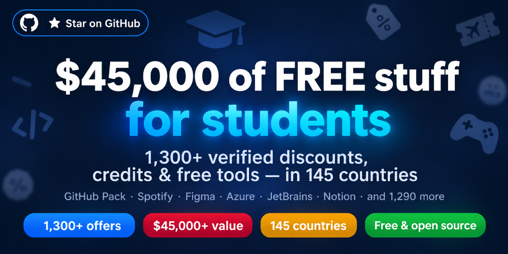

<!--lint disable table-pipe-alignment table-cell-padding double-link no-emphasis-as-heading awesome-list-item-->

# 🎓 Student Offers — The Ultimate List

**Every student discount, credit, freebie and free tool — sorted by category and country, with the verification method for each offer.**

*AI · Dev · Cloud · Learning · Design · Career · Streaming · Money · Scholarships · By country*

**⭐ [Star the repo](https://github.com/ATSDopi/TheStudentRepo) — it helps other students find it.**
[Share on X](https://twitter.com/intent/tweet?text=Every%20student%20discount%2C%20credit%20%26%20freebie%20%E2%80%94%20sorted%20by%20category%20and%20country%20%F0%9F%8E%93&url=https%3A%2F%2Fgithub.com%2FATSDopi%2FTheStudentRepo) · [Share on LinkedIn](https://www.linkedin.com/sharing/share-offsite/?url=https%3A%2F%2Fgithub.com%2FATSDopi%2FTheStudentRepo) · [Share on Reddit](https://www.reddit.com/submit?url=https%3A%2F%2Fgithub.com%2FATSDopi%2FTheStudentRepo&title=The%20ultimate%20student%20offers%20list%20%E2%80%94%20every%20discount%2C%20credit%20%26%20freebie%20by%20country) · [Discussions](https://github.com/ATSDopi/TheStudentRepo/discussions)

A community-maintained, international list of everything a student can get for free or cheap: student software discounts, cloud credits, free developer tools, free courses and certificates, scholarships, transport passes, banking perks and more — each entry with its verification method (SheerID, UNiDAYS, Student Beans, GitHub Student Developer Pack, ISIC…). **Contributions welcome.**

---

## 📑 Contents

- [🔑 Step 0 — Get verified](#-step-0--get-verified-unlocks-90-of-all-offers) — unlocks ~90% of all offers
- [⭐ Top 10](#-top-10--do-these-first) — the highest-value offers first
- [🆕 Recently added](#-recently-added) — newest verified finds
- [📚 Browse the list](#-browse-the-list) — 11 category pages
- 📖 Category docs: [AI](docs/ai.md) · [GitHub Pack](docs/github-pack.md) · [Dev & cloud](docs/dev.md) · [Design](docs/design.md) · [Learning](docs/learning.md) · [Career](docs/career.md) · [Productivity](docs/productivity.md) · [Entertainment](docs/entertainment.md) · [Money](docs/money.md) · [Scholarships](docs/scholarships.md) · [By country](docs/countries.md)
- [⚠️ Pitfalls & deadlines](#️-pitfalls--deadlines) · [🚀 Action plan](#-action-plan) · [🤝 Contributing](#-contributing)

---

## 🔑 Step 0 — Get verified (unlocks ~90% of all offers)

Almost every offer on this list gates behind one of these verification systems. Set them up **once**, then claim everything.

| Method | What it is | Used by | Link |
|---|---|---|---|
| **School / university email** | `.edu`, `.ac.uk`, `.ac.*`, school-issued address | JetBrains, Microsoft, Autodesk, Notion… | your institution's portal |
| **Student ID + enrollment certificate** | Official proof of enrollment | SheerID checks, museums, transport | your registrar / student office |
| **GitHub Education** | Verified student status → unlocks the **Student Developer Pack** (70+ offers) | Copilot, domains, cloud credits… | [Apply](https://education.github.com/discount_requests/application) |
| **SheerID** | Third-party verification used by most global brands | Spotify, Cursor, YouTube, Autodesk, Nike… | automatic during signup |
| **UNiDAYS** | Student discount platform | Apple, Nike, Samsung, ASOS… | [myunidays.com](https://www.myunidays.com) |
| **Student Beans** | Student discount platform | VPNs, fashion, software | [studentbeans.com](https://www.studentbeans.com) |
| **ISIC card** | International Student Identity Card — 130+ countries | Travel, museums, software abroad | [isic.org](https://www.isic.org) |
| **Youth/age status** | Many offers are for "under 26/27" — no student proof needed, just ID | EU museums, rail cards, cinemas | national ID |
| **OnTheHub / your school's software portal** | Academic store run for your institution — free/cheap SPSS, Minitab, Windows, VMware… | School account | [onthehub.com](https://onthehub.com) |
| **ID.me (US)** | Identity verification used by US brands/government | Best Buy, Lenovo, US student deals | [id.me](https://www.id.me) |

> ⚠️ **GitHub verification takes ~72 h.** Apply day one, claim everything else while you wait.

---

## ⭐ Top 10 — do these first

| # | Offer | What you get | Verify via | Link |
|---|---|---|---|---|
| 1 | **GitHub Student Developer Pack** | 70+ pro tools free (Copilot, JetBrains, domains, cloud…) | GitHub Education | [education.github.com/pack](https://education.github.com/pack) |
| 2 | **Microsoft Azure for Students** | $100/yr of cloud **no credit card** | School email / proof | [azure.microsoft.com/free/students](https://azure.microsoft.com/free/students/) |
| 3 | **Cursor Pro** | 12 months free (~$240) | SheerID | [cursor.com/students](https://cursor.com/students) |
| 4 | **JetBrains All Products** | Every pro IDE free | School email / ISIC / GitHub | [jetbrains.com/community/education](https://www.jetbrains.com/community/education/) |
| 5 | **Figma Education** | Figma Pro + FigJam free | School email / SheerID | [figma.com/education](https://www.figma.com/education/) |
| 6 | **Notion Plus Education** | Notion Plus plan free | School email | [notion.so/students](https://www.notion.so/students) |
| 7 | **UNiDAYS + Student Beans** | Unlocks most hardware/fashion discounts | Platform signup | [myunidays.com](https://www.myunidays.com) |
| 8 | **Spotify / Apple Music Student** | ~50% off (+ Apple TV+ with Apple Music) | SheerID / UNiDAYS | [docs/entertainment.md](docs/entertainment.md) |
| 9 | **Microsoft 365 Education** | Office free at eligible institutions | School email | [microsoft.com/education](https://www.microsoft.com/education) |
| 10 | **ISIC card** | Student proof that works in 130+ countries | Enrollment certificate | [isic.org](https://www.isic.org) |

---

## 📚 Browse the list

| Category | File | What's inside |
|---|---|---|
| 🤖 **AI & coding assistants** | [docs/ai.md](docs/ai.md) | Cursor free year, Copilot, Perplexity/ElevenLabs + free AI & API tiers |
| 🐙 **GitHub Student Developer Pack** | [docs/github-pack.md](docs/github-pack.md) | One signup → 80+ offers: Copilot, domains, cloud, courses, tools |
| ☁️ **Dev tools, cloud & free tiers** | [docs/dev.md](docs/dev.md) | Azure/AWS/Oracle, free ML GPUs (Kaggle/Colab) + a complete $0 hosting stack |
| 🎨 **Design, 3D, engineering & audio** | [docs/design.md](docs/design.md) | Figma, Autodesk, **free** Ansys/Siemens NX/Substance/Lumion/Vectorworks, Ableton -50% + free assets |
| 📖 **Learning, courses & textbooks** | [docs/learning.md](docs/learning.md) | freeCodeCamp, CS50, MOOCs, cyber training, OpenStax, **free certifications** (AWS/Oracle/IBM) |
| 💼 **Career & internships** | [docs/career.md](docs/career.md) | Free CV builders, interview prep, **paid fellowships** (GSoC, IAESTE, CERN…), job boards, volunteering |
| 🧠 **Study tools & useful sites** | [docs/productivity.md](docs/productivity.md) | Anki, Obsidian, VPN student deals, open-source alternatives, 100+ everyday websites |
| 📺 **Streaming, media & gaming** | [docs/entertainment.md](docs/entertainment.md) | Spotify/Apple/YT student plans, Headspace -85%, free games & **legal free streaming** |
| 💰 **Money, banking & budgeting** | [docs/money.md](docs/money.md) | No-fee accounts, budgeting apps, tech student stores, paid studies, money traps |
| 🎓 **Scholarships & grants** | [docs/scholarships.md](docs/scholarships.md) | Erasmus Mundus, Fulbright, DAAD, GKS, Mastercard Foundation + databases |
| 🗺️ **Offers by country** | [docs/countries.md](docs/countries.md) | 140 country sections (~145 countries) + EU + **student flight fares** — transport, banking, gov aid |

> 🚧 Country sections beyond France are works in progress — **[add yours](CONTRIBUTING.md)**!

### 🆕 Recently added

| New find | Where |
|---|---|
| ✈️ **Student flight fares** — Qatar Student Club, Turkish (-20%), Emirates, Singapore, Cathay, Lufthansa, Air France youth | [countries.md](docs/countries.md#-student-flight-fares--international) |
| 🏗️ **Free engineering suites** — Ansys Student, Siemens NX/Solid Edge/Simcenter, Altair, PTC Creo, ArchiCAD | [design.md](docs/design.md) |
| 🎬 **Free pro creative tools** — Substance 3D, Lumion Pro, Vectorworks, Foundry (Nuke), D5 Render, Twinmotion | [design.md](docs/design.md) |
| 🛡️ **VPN student deals** — NordVPN -81%, Surfshark -88%, Proton -70% (Student Beans) | [productivity.md](docs/productivity.md) |
| 📚 **Free certifications** — AWS Educate, Oracle Foundations, IBM SkillsBuild, MongoDB U | [learning.md](docs/learning.md) |
| 🌍 **11 new countries** — Russia (free budget places!), Belarus, Georgia, Armenia, Azerbaijan, Moldova, Montenegro, Kosovo, Suriname, Belize, Mozambique | [countries.md](docs/countries.md) |

### Legend — every category page is split in two

| Badge | Meaning |
|---|---|
| 🎓 **Student offers** | Require proof of student status — the *Verify via* column tells you exactly which one |
| 🆓 **Free for everyone** | Usable by any student with **no verification** — the *Limits* column states quotas/caps (or "Fully free") |

---

## ⚠️ Pitfalls & deadlines

<b>Expand the table</b>

| Offer | The catch |
|---|---|
| Google AI student offers | Enrollment deadlines apply + card required → set a reminder before it renews at full price |
| Cursor Pro | Falls back to ~$20/mo after the free year → cancel if you're not continuing |
| ChatGPT student promos | Some are **US-university only** — check eligibility first |
| Canva Education | Reserved for **primary/secondary** schools → use Affinity (free) or Figma |
| Tableau for Students | Now gives **Tableau Public Edition**, not a renewable license → save/publish accordingly |
| Udemy | Permanent "sales" — never pay more than ~$15 for a course |
| AWS Educate | **No longer gives cloud credits** → use AWS Student Rewards instead |
| DigitalOcean | Offer **expired** (left the Pack mid-2026) → use Azure/Oracle instead |
| Postman Student Program | **Discontinued** — only the free plan remains |
| Suno Student | **Gone** — students.suno.com no longer exists and suno.com/pricing has no student plan |
| Webflow Students | **Discontinued** (early 2026) → use Framer's free student plan instead |
| Brilliant, Xbox Game Pass, Netflix, HBO | **No student plan exists** — blog posts claiming one are outdated or affiliate bait |
| 🇫🇷 €1 CROUS meals | Requires a **student card + active Izly account**, 1 meal per service |
| 🇫🇷 Pass Culture | No new credit after 18; existing balance usable until 21 |
| "Free lifetime Copilot", unofficial discount sites | **Scams** — never enter payment info outside official stores |
| Scholarship "application fees" | **Scams** — real scholarships are always free to apply for |
| Shadow libraries for textbooks | Legal risk — use OpenStax/Unpaywall/your library instead → [docs/learning.md](docs/learning.md) |

---

## 🚀 Action plan

- [ ] **Day 1** — Apply to GitHub Education → unlocks 70+ offers in ~72 h
- [ ] **Day 1** — Azure for Students + Cursor + Zed + Google AI (all direct-verify, no wait)
- [ ] **Week 1** — UNiDAYS + Student Beans + ISIC card + your country's student ID/transit card
- [ ] **Check your institution's portal** — Microsoft 365, LinkedIn Learning, MATLAB, journals… often already included
- [ ] **If you move out** — housing aid / guarantor programs in your country (e.g. Visale + APL in France)
- [ ] **Apply for aid** — national grants + your university's bursary fund → [docs/scholarships.md](docs/scholarships.md)
- [ ] **Flying for studies?** — check student fares before booking: Qatar, Turkish, Emirates & more give 10-20% off + extra baggage → [countries.md](docs/countries.md#-student-flight-fares--international)
- [ ] **International student in the US?** — no FAFSA? Look at MPOWER/Prodigy no-cosigner loans + your country's own aid schemes |

---

## 🤝 Contributing

Offers expire fast — help keep this the best student list on GitHub:

- **Report an expired offer** → open an issue with the *Expired offer* template
- **Add an offer** → PR following the format in [CONTRIBUTING.md](CONTRIBUTING.md)
- **Add a free resource** (courses, tools, sites) → *New resource* issue template
- **Add your country** → copy a country block in [docs/countries.md](docs/countries.md)
- **Fix a price/link** → PRs welcome, link to the official page

Our CI checks all links weekly — dead links get flagged automatically.

---

💰 **Estimated cumulative value: $45,000+** in software, cloud credits, courses, scholarships and discounts — if every offer on this list were claimed.

*Community-maintained list — offers change quickly; always re-check the terms before signing up. Not affiliated with any listed company.*

